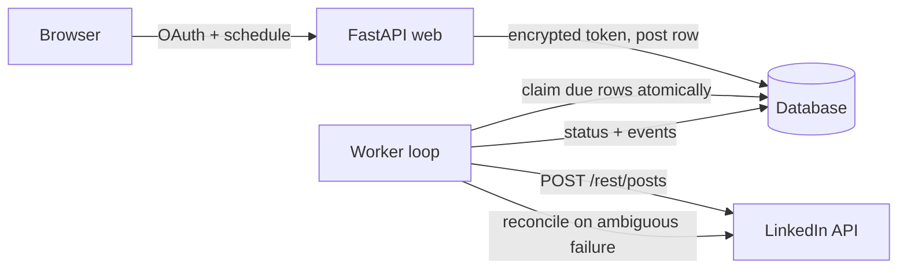

# LinkedIn Post Scheduler

Schedule one (or many) LinkedIn posts. A separate worker publishes them on time with exponential-backoff retries and **duplicate-post protection**.

Stack: Python 3.12, FastAPI, SQLAlchemy (SQLite; swap `DATABASE_URL` for Postgres), httpx, Fernet encryption.

## Architecture

Post lifecycle: `scheduled → processing → published | failed`; a retryable error returns `processing → scheduled` with a later `next_attempt_at`.

## Setup
1. Create a LinkedIn app at https://www.linkedin.com/developers/apps. Add products **Share on LinkedIn** and **Sign In with LinkedIn using OpenID Connect**. Add redirect URL `http://localhost:8000/auth/linkedin/callback`.
2. `cp .env.example .env` and fill in client id/secret, `TOKEN_ENCRYPTION_KEY`, `SESSION_SECRET` (commands are in the file).
3. Run:
```bash
python -m venv .venv && source .venv/bin/activate
pip install -r requirements.txt
uvicorn app.main:app --reload          # terminal 1
python -m app.worker                   # terminal 2
```
or `docker compose up --build`.
4. Open http://localhost:8000 → **Connect LinkedIn** → enter content + date/time → Schedule.
5. Tests: `pytest -q` (no network needed; LinkedIn calls are mocked).

## Database schema
```sql
CREATE TABLE users (
  id INTEGER PRIMARY KEY, linkedin_sub VARCHAR(64) UNIQUE NOT NULL, person_urn VARCHAR(128) NOT NULL,
  name VARCHAR(255), access_token_enc TEXT NOT NULL,   -- Fernet ciphertext
  refresh_token_enc TEXT, token_expires_at DATETIME NOT NULL, created_at DATETIME);
CREATE TABLE scheduled_posts (
  id INTEGER PRIMARY KEY, user_id INTEGER NOT NULL REFERENCES users(id),
  content TEXT NOT NULL, content_hash VARCHAR(64) NOT NULL,
  scheduled_at DATETIME NOT NULL,                     -- UTC
  status VARCHAR(16) NOT NULL,                        -- scheduled|processing|published|failed
  attempts INTEGER NOT NULL, next_attempt_at DATETIME NOT NULL, locked_at DATETIME,
  send_started_at DATETIME,                           -- set before HTTP call; marks "outcome possibly unknown"
  linkedin_post_urn VARCHAR(128), last_error TEXT, published_at DATETIME, created_at DATETIME, updated_at DATETIME,
  UNIQUE (user_id, content_hash, scheduled_at));
CREATE INDEX ix_due ON scheduled_posts(status, next_attempt_at);
CREATE TABLE post_events (id INTEGER PRIMARY KEY, post_id INTEGER REFERENCES scheduled_posts(id),
  ts DATETIME, level VARCHAR(8), message TEXT);       -- audit log
```

## Requirement mapping
| Requirement | Implementation |
|---|---|
| LinkedIn OAuth | Authorization-code flow with random `state` (CSRF check), scopes `openid profile w_member_social` (`app/main.py`, `app/linkedin.py`) |
| Secure token storage | Tokens encrypted with Fernet before hitting the DB; key from env; never logged or returned by the API |
| Scheduled job | `app/worker.py` polls for `status=scheduled AND next_attempt_at<=now` (UTC) |
| Statuses | `scheduled, processing, published, failed` |
| Retry + increasing delays | `delay = base·2^(n-1)`, capped, ±20% jitter, honours `Retry-After`; max attempts configurable |
| Error handling | Errors classified: Retryable (429/503/connect), Ambiguous (timeouts/500/502/504), Permanent (401/403/422/…) |
| Duplicate protection | See below |
| Logging | Structured stdout logs + per-post `post_events` table (`GET /api/posts/{id}/events`) |

### Duplicate-post protection (layers)
1. **Submission guard** – unique `(user, content_hash, scheduled_at)` blocks double-clicks → 409.
2. **Atomic claim** – `UPDATE … SET status='processing' WHERE id=? AND status='scheduled'`; only one worker gets rowcount 1, so multiple workers are safe.
3. **Write-ahead marker** – `send_started_at` is committed *before* the HTTP call. If a request times out or returns 500/502/504, LinkedIn may or may not have created the post.
4. **Reconcile before resend** – the next attempt first lists the author's recent posts; if a match exists it is marked `published` instead of re-sent. If it cannot be verified (listing needs the restricted `r_member_social` scope), the post is marked `failed` rather than risk a duplicate (fail-safe).
5. Only responses where the request provably never ran (connect error, 429, 503) are retried blindly.
6. Crashed workers: stale `processing` rows are recovered after `LOCK_TIMEOUT_SECONDS` and go through step 4.

## Notes / limits
- LinkedIn access tokens last ~60 days; refresh tokens are only issued to approved partners. Expired token ⇒ post fails with a "reconnect" message; scheduling beyond expiry is rejected.
- Posts API version is set by `LINKEDIN_API_VERSION` (LinkedIn retires old versions).
- Scaling: use Postgres and add `FOR UPDATE SKIP LOCKED` in `tick()` if you run many workers (the atomic claim is already safe).
- Live demo: deploy web + worker to Render/Fly/Railway (shared volume or Postgres), set the redirect URI to the public URL.
